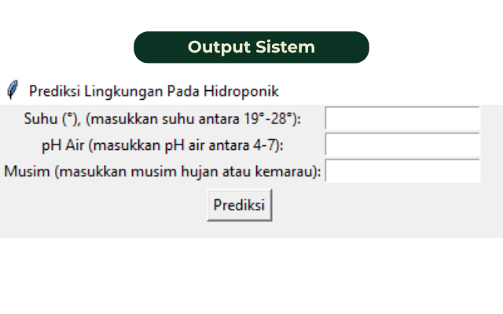
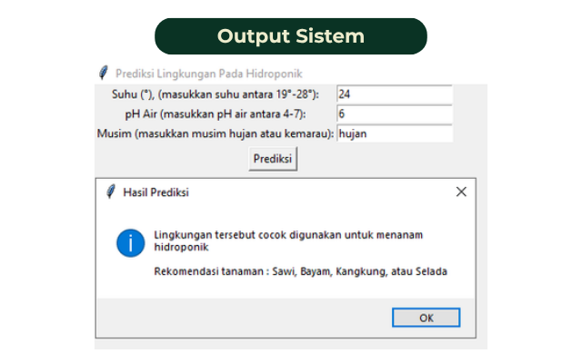

# Sistem-Klasifikasi-Lingkungan-Hidroponik
Proyek machine learning untuk mengklasifikasikan kesesuaian kondisi lingkungan bagi budidaya hidroponik berdasarkan parameter suhu, pH air, dan musim.

Proyek ini bertujuan untuk mengklasifikasikan kesesuaian kondisi lingkungan untuk budidaya hidroponik menggunakan algoritma Random Forest Classifier. Model dikembangkan menggunakan Python dengan memanfaatkan data parameter lingkungan, seperti suhu, pH air, dan musim.

Selain membangun model machine learning, proyek ini juga mengimplementasikan antarmuka grafis (Graphical User Interface atau GUI) menggunakan Tkinter. Pengguna dapat memasukkan parameter lingkungan untuk memperoleh hasil prediksi kesesuaian hidroponik beserta rekomendasi tanaman.

#### Tujuan
1. Mengolah data parameter lingkungan sebagai persiapan untuk pemodelan machine learning.
2. Membangun model Random Forest untuk klasifikasi kondisi lingkungan hidroponik.
3. Mengevaluasi performa model menggunakan metrik klasifikasi.
4. Mengembangkan aplikasi sederhana untuk menampilkan hasil prediksi dan rekomendasi tanaman.

#### Tools dan Teknologi
|Tools|Keterangan|
|---|---|
|Python | Bahasa pemrograman utama.|
|Pandas | Pengolahan dan manipulasi data.|
|NumPy | Pengolahan data numerik.|
|Scikit-learn | Pembagian dataset, pembangunan model Random Forest, dan evaluasi klasifikasi.|
|Matplotlib | Pustaka visualisasi data.|
|Tkinter | Pembuatan antarmuka grafis aplikasi.|
|Random Forest| Algoritma Machine Learning.|

#### Tahapan Pengerjaan
1. Memuat dataset  
Membaca dataset menggunakan Pandas dan memeriksa struktur, kolom, serta jumlah data.
2. Preprocessing data  
Mengonversi nilai pH air ke format numerik dan menerapkan one-hot encoding pada variabel kategorikal.
3. Pembagian dataset  
Membagi data menjadi data latih dan data uji dengan proporsi 80:20.
4. Pembangunan model  
Melatih model Random Forest Classifier dengan 100 pohon keputusan (estimators).
5. Evaluasi model  
Menghasilkan classification report dan menghitung akurasi pada data uji.
6. Pengembangan aplikasi GUI  
Membuat antarmuka menggunakan Tkinter agar pengguna dapat memasukkan suhu, pH air, dan musim untuk memperoleh prediksi.
7. Penyajian rekomendasi  
Menampilkan rekomendasi tanaman berupa sawi, bayam, kangkung, atau selada ketika hasil prediksi menunjukkan kondisi lingkungan yang sesuai.

#### Fitur Aplikasi
- Input suhu lingkungan.
- Input pH air.
- Input kondisi musim, yaitu hujan atau kemarau.
- Prediksi kesesuaian lingkungan untuk budidaya hidroponik.
- Rekomendasi jenis tanaman berdasarkan hasil prediksi.
- Pesan kesalahan ketika input tidak sesuai dengan format yang diharapkan.

#### Cara Menggunakan aplikasi
1. Masukkan suhu lingkungan.
2. Masukkan nilai pH air.
3. Masukkan musim dengan mengetik hujan atau kemarau.
4. Klik tombol Prediksi.
5. Baca hasil klasifikasi dan rekomendasi tanaman yang ditampilkan.

#### Preview Output

### Catatan
Hasil prediksi bergantung pada dataset dan model yang telah dilatih. Rekomendasi tanaman pada aplikasi menggunakan aturan yang ditentukan di dalam kode, sehingga tidak berarti setiap tanaman telah diprediksi secara terpisah oleh model.
